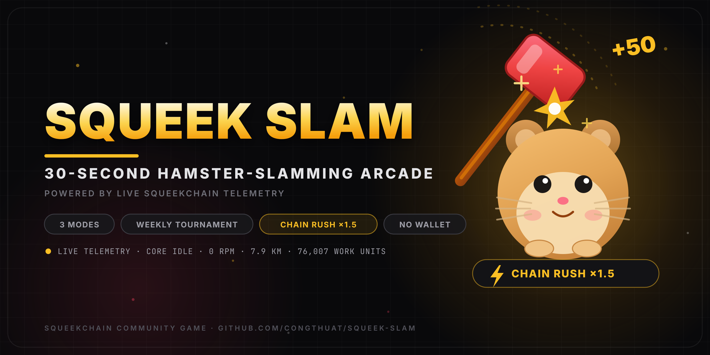

<div align="center">



# 🐹🔨 Squeek Slam

**A 30-second hamster-slamming arcade game driven by live SqueekChain telemetry.**
The real hamster's wheel is the game engine: while it runs, every slam pays **×1.5**.

[](https://react.dev)
[](https://www.typescriptlang.org)
[](https://vite.dev)
[](https://tailwindcss.com)
[](https://expressjs.com)
[](https://www.postgresql.org)
[](LICENSE)

<em>Live demo — add the hosted URL here</em>

</div>

---

## What is Squeek Slam?

Squeek Slam is a browser arcade game built for the **SqueekChain** community, where the chain's
proof-of-work comes from a real hamster running in a wheel. Instead of a static scoreboard, the game
reads the hamster's live telemetry — core status, RPM, distance, cumulative work units and block
height — straight from the public SqueekChain API and lets it shape the round: when the real hamster
is running, a **Chain Rush** kicks in and every slam is worth **×1.5**.

One round lasts 30 seconds, escalates through four phases, and ends with a grade, a rank on the
leaderboard and a shot at the weekly tournament crown. It runs on phones and desktops, in Vietnamese
or English, with mouse, touch or keyboard — and it never asks for a wallet.

## ✨ Features

| | |
|---|---|
| 🏃 **Chain Rush** | Live hamster state multiplies every hit by ×1.5, with an in-game announcement |
| ⏱ **Four round phases** | Warm-up (0–8s) → Speed-up (8–20s) → Frenzy (20–25s) → Final 5s (points ×2) |
| 🎚 **Three difficulty modes** | Standard ×1 · Hard ×1.25 · Insane ×1.5 — each with its own leaderboard |
| 🏆 **Weekly tournament** | Monday 00:00 UTC reset, live countdown, champion crown, top-3 podium |
| 📊 **Leaderboard** | Filters for this week / today / all time, plus per-mode tabs |
| 🔥 **Combo system** | Chained hits up to ×5, quick-hit bonus (+5), golden hamster (+50), clock (+3s), bombs (−20) |
| 🅰️ **Round results** | S/A/B/C/D grade, accuracy, top combo, personal-best celebration, share button |
| 🌐 **Bilingual UI** | Vietnamese (default) and English, remembered locally |
| 🎮 **Every input** | Mouse, touch and keyboard (Space to start, keys 1–9 to slam) |
| 🔒 **No wallet** | No connection, no NFTs, no tokens — off-chain fun points only |

## 🛰 Live SqueekChain data

The game never invents numbers. Every telemetry value comes from the public SqueekChain API:

| Upstream endpoint | Used for |
| --- | --- |
| `GET https://api.squeekchain.com/v1/status` | core status (`RUNNING` / `IDLE`), RPM, distance, cumulative work units, block height |
| `GET https://api.squeekchain.com/v1/core` | chain / core identity (`chainId`) |

The backend proxies them at `GET /api/chain/status` with an **8 s cache** and a **6 s timeout**, and
keeps serving the last known values if upstream is slow or offline, so the game never blocks on the network.
The UI polls every 10 seconds and shows the live strip — status, RPM, kilometres and work units — inside the game card.

**Chain Rush** switches on when the core reports `RUNNING` or the RPM is above zero: an amber badge lights up,
a banner announces it, and every slam pays ×1.5 until the hamster stops.

## 🎚 Difficulty modes

| Mode | Spawn speed | Target lifetime | Concurrent targets | Bomb penalty | Points |
| --- | --- | --- | --- | --- | --- |
| Standard | 1.00× | 1.00× | up to 2 | −20 | ×1 |
| Hard | 1.19× | 1.11× | up to 3 | −25 | ×1.25 |
| Insane | 1.43× | 1.22× | 2–3 | −30 | ×1.5 |

Grades are normalised by the mode multiplier — **S** ≥ 3000 · **A** ≥ 2000 · **B** ≥ 1200 · **C** ≥ 600 —
so a Standard S and an Insane S both mean the same level of play.

## 🏗 Architecture

```
frontend/   Vite + React + TypeScript app — game loop, UI, i18n, WebAudio SFX
backend/    Express API — SqueekChain proxy, leaderboard, weekly tournament, scores
            └─ db/schema.js — Drizzle table definitions (auto-synced to Postgres)
docs/       Banner artwork (editable SVG source + rendered PNG)
```

**Frontend** — React 19, TypeScript, Vite 6, Tailwind CSS 4, TanStack Query for polling and caching,
`lucide-react` icons, and a custom WebAudio synthesizer for sound effects (no audio assets to ship).

**Backend** — Node.js + Express 4 on top of the Surf SDK: `@surf-ai/sdk/server` boots the HTTP server and
`@surf-ai/sdk/db` exposes `dbQuery()` for Postgres access. The SDK provisions the database and syncs
`backend/db/schema.js` on startup.

**Database** — one row per finished round in `game_scores`:

| Column | Meaning |
| --- | --- |
| `player_name` | Display name chosen by the player |
| `score` | Final score (mode / Chain Rush multipliers already applied) |
| `mode` | `standard` · `hard` · `insane` |
| `max_combo` | Longest combo chain in the round |
| `hits` / `misses` | Slams that connected / missed |
| `created_at` | Round timestamp (used for daily / weekly scopes) |

## 🔌 API routes

| Method | Route | Description |
| --- | --- | --- |
| `GET` | `/api/health` | Service liveness |
| `GET` | `/api/chain/status` | Cached SqueekChain telemetry (status, RPM, distance, work units, block) |
| `GET` | `/api/game/leaderboard?range=week\|today\|all&mode=all\|standard\|hard\|insane&limit=…` | Leaderboard |
| `GET` | `/api/game/tournament?mode=…` | Current ISO week: countdown data, champion, top 10, runs |
| `POST` | `/api/game/scores` | Submit a finished round, returns the player's rank |
| `GET` | `/api/game/stats` | Community totals (games played, hits, best score) |

## 🚀 Getting started

Requirements: **Bun** (or Node 22+), and a **Surf API key** for the backend.

```bash
# 1 — backend (http://localhost:3001)
cd backend
bun install
cp .env.example .env      # then set SURF_API_KEY (BACKEND_PORT defaults to 3001)
bun run dev

# 2 — frontend (http://localhost:5173)
cd ../frontend
bun install
cp .env.example .env      # PORT=5173, BACKEND_PORT=3001, BASE_PATH=
bun run dev
```

The backend validates its environment on boot and the Vite dev server proxies `/api/*` to it,
so the frontend only ever talks to its own origin. Postgres is provisioned automatically by the SDK
and the schema in `backend/db/schema.js` is applied on start.

## 🎮 How to play

1. Pick a difficulty, type a name, press **Space** (or tap **Start**).
2. Slam the holes: **click / tap** them, or use the **number keys 1–9** laid out like the 3×3 board.
3. Chain hits without missing to grow the combo multiplier (up to ×5) — the combo bar shows the decay window.
4. Dodge the bombs, grab the golden hamster and the clock, and cash in the final five seconds when everything pays double.
5. Watch the **CHAIN RUSH** badge: while the real hamster is running, your round is worth ×1.5.

| Event | Effect |
| --- | --- |
| Hamster | +10 |
| Golden hamster | +50 |
| Clock | +3 seconds |
| Bomb | −20 and combo reset (penalty scales with difficulty) |
| Quick hit (within 0.3 s of a spawn) | +5 |
| Combo chain | up to ×5 |
| Final 5 seconds | points ×2 |
| Chain Rush (live hamster running) | points ×1.5 |

## ⚖️ Disclaimer

Squeek Slam is an **unofficial community fan project** for the SqueekChain community game jam.
Points are **off-chain, for fun, and are not real $SQK**. The game connects to no wallet, mints nothing
and makes no claims about official Squeek mining, yield, insurance or airdrops.
All chain data shown is read from the public SqueekChain API.

## 📄 License

[MIT](LICENSE) — do what you like, no warranty.
